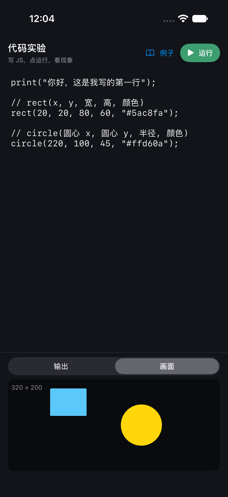

# CodeLab

iPhone 上写代码、点运行、看现象。给自学编程的人一个不用开电脑的小实验场。

**它不是编译器。** 用的是 iOS 自带的 JavaScriptCore（Safari 同款引擎），逐句解释执行，没有生成机器码。iOS 不允许第三方 App 在运行时生成可执行代码，所以这里既没有 JIT，也跑不了 C/Swift——这套限制是公开的，不是偷懒。

## 能做什么

- `print(...)` / `console.log(...)`：输出到底部控制台
- `rect(x, y, w, h, color)`、`circle(cx, cy, r, color)`：画到 320×200 的逻辑画布
- `clear()`：清空画布
- 内置六个例子：变量、循环、条件、函数、数组、画图

死循环（`while(true)`、`for(;;)`）会被提前拦下：JS 跑在单独线程上，解释器停不下来，不能让它把一个 CPU 核占死。

## 跑起来

1. Xcode 16+，iOS 17.0+
2. 打开 `CodeLab.xcodeproj`，在 Signing 里填自己的 Team，把 Bundle Identifier 从 `com.example.codelab` 改成你自己的
3. ⌘R

## 结构

| 文件 | 干什么 |
| --- | --- |
| `CodeEngine.swift` | `JSContext` 执行代码，`print`/`rect`/`circle` 通过 block 桥回原生 |
| `CodeEditor.swift` | 用 `UITextView` 而不是 SwiftUI `TextEditor`：要关掉智能引号，否则打出来的 `"` 会变成中文引号 |
| `ShapeCanvas.swift` | 逻辑坐标 320×200，SwiftUI `Canvas` 等比缩放绘制 |
| `Lessons.swift` | 内置例子 |

## 为什么值得看

一个 iOS App 想「跑用户写的代码」，只有这条路：系统自带的 JS 引擎 + 原生桥接。想在手机里做真编译（C、LLVM）在 App Store 规则下没有合法解法。这个项目就是那条路的最小可用版本，600 行。

## 已知限制

- 第三方 App 的 JSC 没有 JIT，纯解释器，比 Mac 上慢一截
- 画布只有矩形和圆，没有线条和文字
- 界面是中文的
- 代码保存在 `UserDefaults`，只在本机

## License

MIT